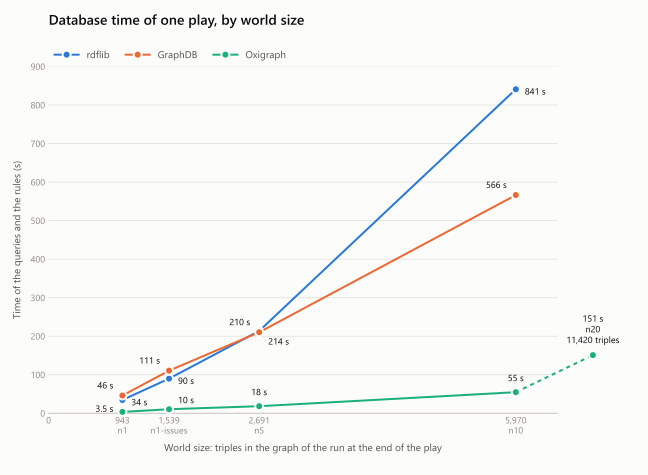
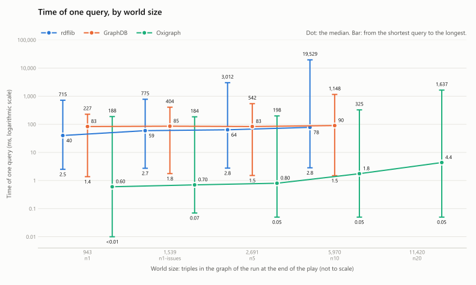

Two tools evaluate OntoGSN. The reports are regenerated for each new version of the ontology.

| Report | What it checks | Ontology | Tool | Result |
| :--- | :--- | :--- | :--- | :--- |
| [OOPS! pitfall scan](oops/) | Frequent modelling mistakes, for example a property without a domain, or a class that is used in its own definition | 1.3.0 | OOPS! 0.3.0-SNAPSHOT | 4 important and 4 minor pitfalls, 0 critical |
| [FOOPS! FAIR assessment](foops/) | How findable, accessible, interoperable and reusable the published ontology is | 1.3.0 | FOOPS! 0.4.0 | 24 of 24 checks pass, score 100 % |

WIDOCO generates the [documentation](../documentation/) in the same way.

## The pitfalls that stay

Some pitfalls are correct findings that OntoGSN keeps on purpose. The [design record](https://github.com/fortiss/OntoGSN/tree/main/development/design) gives the reason for each decision.

| Pitfall | Importance | Affects | Status |
| :--- | :--- | :--- | :--- |
| P10 Missing disjointness | Important | The class hierarchy | Open |
| P11 Missing domain or range | Important | `schema:description`, `schema:identifier` | Kept. A domain on a term of another vocabulary changes that vocabulary. |
| P24 Recursive definitions | Important | `gsn:Goal`, `gsn:Module`, `gsn:Relationship` | Kept. Design decision dd-1087. |
| P30 Equivalent classes not declared | Important | `rdf:Statement` and `gsn:Argument` | Kept. A false match, design decision dd-1088. |
| P08 Missing label and comment | Minor | `schema:description`, `schema:identifier` | Kept. Each OntoGSN term has a definition. |
| P13 Inverse relationships not declared | Minor | 14 object properties | Kept. Design decision dd-1086. |
| P13 Symmetric or transitive? | Minor | `gsn:relatedTo` | Open |
| P34 Untyped class | Minor | 8 terms of the SWRL vocabulary | Kept. The SWRL vocabulary is not OntoGSN's to declare. |

OOPS! did not evaluate P06 (cycles in the class hierarchy), because the checker failed. A local query in `development/dev_tools/oops_check.py` runs the same check. It finds no cycle.

## Database Evaluations

We compared three databases on the same task: rdflib, Oxigraph and GraphDB. The task is one complete run of an audit process that reads and changes an OntoGSN assurance case with SPARQL queries and rules. We ran it on synthetic cases of five sizes, from about 900 to about 11,400 triples at the end of the run. Each database ran each size once, on one laptop. Only Oxigraph ran the largest size.

The first chart shows the total time that the database worked in one run. Oxigraph is the fastest at every size, and its lead grows with the size. At 5,970 triples it took 55 s, GraphDB took 566 s and rdflib took 841 s.

The second chart shows the time of one query, on a logarithmic scale. The dot is the median, and the bar goes from the shortest query to the longest. The median changes little with the size. The longest query grows, most of all on rdflib: from 0.7 s to 19.5 s.
